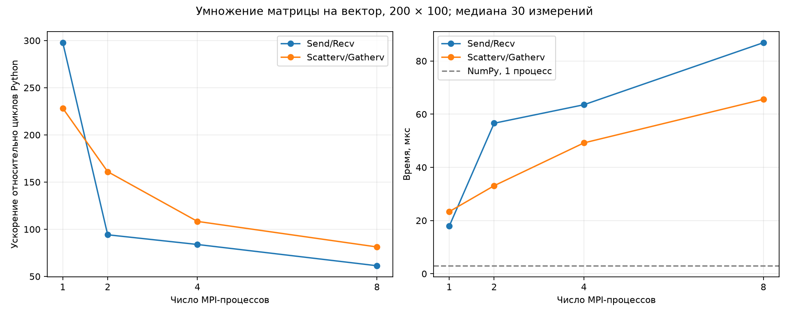

# Лабораторная работа № 1

## Параллельное умножение матрицы на вектор с использованием MPI в Python

| Сведения | Значение |
|---|---|
| Дисциплина | Параллельные вычисления |
| Студент | Исмаилов Самир Рамазан Оглы |
| Группа | ПИН-м-о-26-1 |
| Дата эксперимента | 27 октября 2026 г. |
| Язык и библиотеки | Python, NumPy, mpi4py |

## 1. Цель и постановка задачи

Цель работы — освоить обмен данными между MPI-процессами и сравнить последовательное вычисление с двумя вариантами параллельного алгоритма.

Дана матрица `A` размером `M × N` и вектор `x` длины `N`. Необходимо получить вектор `b` длины `M`:

$$b_j = \sum_{i=0}^{N-1} A_{ji} x_i, \qquad j = 0,\ldots,M-1.$$

Каждый элемент результата — скалярное произведение одной строки матрицы на вектор. Строки независимы, поэтому их можно распределить между процессами. Общая вычислительная сложность составляет `O(MN)`.

Реализованы три версии: вложенные циклы Python, MPI с `Send/Recv`, MPI с `Scatterv/Gatherv`. Дополнительно проверено неравномерное распределение строк и измерена производительность на матрице `200 × 100`.

## 2. Входные данные и структура решения

В `data/in.dat` сначала записано `N` — число столбцов, затем `M` — число строк. В `data/AData.dat` находятся `M × N` элементов матрицы в порядке строк; допускаются строки матрицы или один элемент на строку. В `data/xData.dat` находятся `N` элементов вектора.

| Файл | Назначение |
|---|---|
| `src/sequential.py` | Чтение данных, проверка размеров, последовательный алгоритм |
| `src/parallel_send_recv.py` | Передача блоков матрицы и частей результата точка-точка |
| `src/parallel_scatterv.py` | Распределение и сбор коллективными операциями |
| `src/mpi_common.py` | Разбиение строк, рассылка размеров, общий ввод и запуск |
| `tests/test_lab.py` | Проверки чтения, разбиения и реальных MPI-запусков |
| `scripts/benchmark.py` | Воспроизведение эксперимента, сохранение таблицы и графика |
| `scripts/benchmark_worker.py` | Прогрев, повторные замеры и проверка результатов |

Последовательная программа записывает `Results_sequential.dat`, обе MPI-программы — `Results_parallel.dat` в текущий каталог. При последовательном запуске MPI-версий второй результат перезаписывает первый. Матрица хранится в NumPy-массиве `float64` по строкам; передаются числовые буферы, а не сериализованные Python-списки.

## 3. Алгоритмы и обмен данными

### 3.1. Последовательное вычисление

Функция `sequential_mat_vec_mult` создаёт нулевой вектор результата. Внешний цикл перебирает строки `j`, внутренний — столбцы `i` и накапливает `A[j, i] * x[i]` в `b[j]`. Ввод и вывод выполняются один раз, отдельно от измерения вычислений.

Для исходных данных шаблона:

```text
     ┌ 1   2   3 ┐       ┌1┐       ┌14┐
     │ 4   5   6 │       │2│       │32│
 A = │ 7   8   9 │,  x = └3┘,  b = │50│
     │10  11  12 │                 │68│
     └13  14  15 ┘                 └86┘

Например: b[0] = 1·1 + 2·2 + 3·3 = 14.
```

### 3.2. Горизонтальное разбиение

Пусть `p` — число процессов. Вычисляются `q, r = divmod(M, p)`. Первые `r` процессов получают по `q + 1` строке, остальные — по `q`. Поэтому нагрузка отличается не более чем на одну строку.

Массив `rcounts[k]` содержит количество строк процесса `k`. Массив `displs[k]` содержит индекс его первой строки. Смещения вычисляются накоплением предыдущих количеств.

Для `M = 7`, `N = 5`, `p = 4`:

| Ранг | Строки A, индексы от 0 | rcounts | displs | Элементы A | Смещение в элементах A |
|---:|---|---:|---:|---:|---:|
| 0 | 0–1 | 2 | 0 | 10 | 0 |
| 1 | 2–3 | 2 | 2 | 10 | 10 |
| 2 | 4–5 | 2 | 4 | 10 | 20 |
| 3 | 6 | 1 | 6 | 5 | 30 |

Для `Scatterv` количества и смещения умножаются на `N`, поскольку передаются элементы матрицы. Для `Gatherv` используются исходные массивы, поскольку каждая строка даёт один элемент `b`.

Если `p > M`, часть процессов получает ноль строк. Они всё равно участвуют в коллективных вызовах; их локальные буферы и части результата имеют нулевую длину.

### 3.3. Общая схема MPI-программы

1. Процесс 0 читает матрицу и вектор, сообщает остальным процессам об успешном чтении или ошибке.
2. Размеры матрицы передаются через `Bcast`, затем рассчитываются размеры блоков.
3. Каждому процессу передаётся его блок строк матрицы и весь вектор `x`.
4. Каждый процесс вычисляет свою часть результата через `np.dot`.
5. Процесс 0 собирает части результата и записывает итоговый вектор в файл.

### 3.4. Версия Send/Recv

Процесс 0 сохраняет свой блок и последовательно отправляет остальные блоки нужным рангам с тегом `10`. Каждый рабочий процесс принимает блок именно от ранга 0. Затем все процессы вызывают `Bcast(x)` и вычисляют `np.dot(local_A, x)`.

Рабочие процессы отправляют свои результаты с тегом `20`, а процесс 0 принимает их в соответствующие участки итогового вектора. Номера источника, получателя и теги согласованы. Процесс 0 не отправляет сообщение самому себе. Такая последовательность не образует циклического ожидания: сначала завершается распределение, затем вычисление и сбор.

### 3.5. Версия Scatterv/Gatherv

`Scatterv` раздаёт блоки разной длины за один коллективный вызов. После рассылки вектора через `Bcast` процессы вычисляют локальные результаты. `Gatherv` собирает части разной длины на процессе 0 в исходном порядке строк.

Все процессы должны вызвать коллективные операции в согласованном порядке, включая процессы с пустыми блоками. Ошибка чтения сначала сообщается всем процессам через `bcast`, после чего все завершаются: остальные ранги не остаются ждать данные от завершившегося процесса 0.

## 4. Проверка корректности

Эталон для случайных матриц — `A @ x` из NumPy. Результаты сравниваются через `np.testing.assert_allclose` с `rtol = 1e-12` и `atol = 1e-12`. Побитовое совпадение не требуется: порядок суммирования вещественных чисел в циклах и в библиотеке может различаться.

| Проверка | Условия | Результат |
|---|---|---|
| Ручной пример | `M=5`, `N=3`, циклы Python | `[14, 32, 50, 68, 86]` |
| Чтение файлов | Два формата матрицы, вектор из одного числа, некорректные размеры | Пройдено |
| Разбиение строк | `(M,p)`: `(7,4)`, `(2,8)`, `(0,4)`, `(8,4)`, `(1,1)` | Пройдено |
| Обе MPI-версии | `M=5`, `N=3`, `p=1` | Совпадение с NumPy |
| Обе MPI-версии | `M=6`, `N=4`, `p=2` | Совпадение с NumPy |
| Обе MPI-версии | `M=7`, `N=5`, `p=4` | Совпадение с NumPy |
| Обе MPI-версии | `M=2`, `N=3`, `p=8` | Совпадение с NumPy; пустые блоки работают |
| Обе MPI-версии | `M=1`, `N=1`, `p=4` | Совпадение с NumPy |

Итого: **17 автоматизированных проверок пройдены**, из них 10 — отдельные запуски настоящих MPI-процессов. Нулевое `M` проверяется только у функции разбиения; входная программа принимает положительные размеры. В эксперименте производительности результаты каждой MPI-итерации также сравниваются с NumPy.

Дополнительно пройдены локальные проверки форматирования Black, стиля flake8 и типов mypy. Все три программы запущены на исходных файлах шаблона; обе MPI-версии на четырёх процессах дали тот же результат, что последовательная программа.

Закрытые тесты преподавателя и удалённый CI не запускались. Их успешное прохождение по локальным проверкам утверждать нельзя.

## 5. Эксперимент по производительности

### 5.1. Условия и методика

| Параметр | Значение |
|---|---|
| ОС | Windows 11, сборка 26200 |
| Python | 3.12.14 |
| NumPy / mpi4py | 2.3.5 / 4.1.2 |
| MPI | Intel MPI 2021.18.1 для Windows |
| Доступные логические процессоры | 12 |
| Матрица | `M=200`, `N=100`, тип `float64` |
| Данные | `np.random.default_rng(42)`, числа от 0 до 1 |
| Число MPI-процессов | 1, 2, 4, 8 |
| Повторы | 5 прогревочных и 30 измеряемых для каждой MPI-версии |
| Итоговая статистика | Медиана времени |

Все процессы работают на одном компьютере. `OMP_NUM_THREADS`, `OPENBLAS_NUM_THREADS` и `MKL_NUM_THREADS` установлены в `1`, чтобы ограничить вложенную многопоточность библиотек.

Перед каждой MPI-итерацией выполняется `Barrier`. Время измеряется через `MPI.Wtime` отдельно на каждом ранге; через `reduce(..., MPI.MAX)` берётся максимальная продолжительность. В интервал входят рассылка размеров, выделение локальных буферов, передача матрицы и вектора, локальное умножение и сбор результата. Сам `Barrier`, сбор значений времени, проверка результата, чтение/запись файлов и запуск Python/MPI в интервал не входят.

Для последовательной версии используется `time.perf_counter`: один прогрев и 30 измерений. Для формулы ускорения всех MPI-запусков фиксируется базовое время циклов из запуска с одним процессом: **0,005330200 с**. Дополнительно измеряется обычный `np.dot(A, x)` без MPI, чтобы отделить оптимизацию локального вычисления от эффекта распараллеливания.

### 5.2. Измеренные результаты

Ускорение относительно последовательных циклов вычисляется как `S = T_seq / T_parallel`.

| Процессы | Send/Recv, с | Scatterv/Gatherv, с | S Send/Recv | S Scatterv/Gatherv |
|---:|---:|---:|---:|---:|
| 1 | 0,000017900 | 0,000023350 | 297,78 | 228,27 |
| 2 | 0,000056600 | 0,000033100 | 94,17 | 161,03 |
| 4 | 0,000063550 | 0,000049200 | 83,87 | 108,34 |
| 8 | 0,000086900 | 0,000065600 | 61,34 | 81,25 |

Здесь `p=1` — MPI-программа с одним процессом. Последовательная программа является отдельным базовым измерением и по определению имеет `S=1`.



Слева показано отношение времени циклов Python к времени MPI-версии, справа — абсолютное время MPI-версий в микросекундах. Пунктир справа — обычный NumPy в одном процессе: около **3,0 мкс**.

Исходные данные эксперимента: [таблица CSV](report/performance.csv), [все измеренные MPI-времена и параметры среды](report/raw_timings.json). Значения в таблице округлены; в файлах сохранена исходная точность.

### 5.3. Интерпретация графика

Большие значения `S`, в том числе при одном MPI-процессе, объясняются прежде всего разными локальными реализациями: последовательная версия выполняет циклы Python, а MPI-версии используют оптимизированный `np.dot`. Поэтому `S > p` здесь **не доказывает сверхлинейное масштабирование MPI**. Эти значения нельзя использовать как подтверждение бонусного критерия ускорения более 3 на четырёх процессах за счёт одного только распараллеливания.

Если сравнить одну и ту же MPI-версию с её запуском на одном процессе, результат другой:

| Процессы | Send/Recv: T(1)/T(p) | Scatterv/Gatherv: T(1)/T(p) |
|---:|---:|---:|
| 1 | 1,000 | 1,000 |
| 2 | 0,316 | 0,705 |
| 4 | 0,282 | 0,475 |
| 8 | 0,206 | 0,356 |

При увеличении числа процессов время растёт. Для такой небольшой матрицы расходы обмена и управления процессами превышают экономию на вычислениях. При `p=2,4,8` версия с коллективными операциями быстрее варианта `Send/Recv` в этом эксперименте. При `p=1` быстрее `Send/Recv`; универсального преимущества всех коллективных операций эти результаты не устанавливают.

Обычный NumPy без MPI быстрее обеих MPI-версий на данном размере. Наибольшее измеренное ускорение относительно циклов составляет около `297,78` у Send/Recv с **одним** процессом; среди многопроцессных запусков — около `161,03` у Scatterv/Gatherv с двумя процессами. Максимальный размер, проверенный в этой работе, — `200 × 100`; это не оценка предельно допустимого размера.

Выводы ограничены одним компьютером, размером задачи и выбранной методикой. Замеры микросекундного масштаба зависят от системной нагрузки и планировщика. Для поиска размера, начиная с которого MPI становится выгодным, нужны отдельные эксперименты на больших матрицах и сравнение с одинаковым локальным вычислительным ядром.

## 6. Пояснения для защиты по вопросам методички

### 6.1. Основы MPI

MPI — стандарт взаимодействия процессов через сообщения. `mpi4py` предоставляет его интерфейс в Python. У каждого процесса отдельная память. Коммуникатор задаёт группу процессов и контекст обмена; `MPI.COMM_WORLD` включает все процессы текущего запуска, `MPI.COMM_SELF` — только вызывающий процесс. Ранг — номер процесса внутри коммуникатора, от `0` до `p-1`. В этой реализации ранг 0 читает данные, участвует в вычислении и собирает результат.

### 6.2. Передача сообщений и дедлоки

Операции точка-точка связывают отправителя и получателя, коллективные выполняются группой процессов. Блокирующий `Send` завершается, когда его буфер можно переиспользовать, но это не обязательно означает, что получатель уже завершил приём. Синхронный `Ssend` требует начала соответствующего приёма. Неблокирующие `Isend/Irecv` возвращают запросы, завершение которых проверяют через `Wait/Test`; буферы до завершения переиспользовать нельзя.

`Send` — стандартная отправка; `Bsend` использует подключённый пользовательский буфер; `Ssend` — синхронная отправка; `Rsend` допустима, только если соответствующий приём уже выставлен. Нельзя полагаться на внутреннюю буферизацию для предотвращения зависаний.

Дедлок — взаимное ожидание, при котором никто не может продолжить. Например, два процесса могут одновременно ждать завершения блокирующих отправок, не выставляя приём. В работе отправке блока соответствует приём рабочего процесса, а сбор начинается после распределения и рассылки вектора.

### 6.3. Коллективные операции

`Bcast` передаёт одинаковые данные от корневого процесса всем участникам. `Scatterv` раздаёт разные фрагменты с заданными количествами и смещениями; `Gatherv` собирает их на корне. В обычных `Scatter/Gather` блоки имеют одинаковую длину. `Allgatherv` доставляет собранный результат каждому участнику; в этой задаче это лишнее, поскольку результат записывает только ранг 0.

MPI-библиотека может выбирать эффективные алгоритмы коллективного обмена, например древовидные. Поэтому коллективные операции часто удобнее и быстрее ручного обмена, но преимущество зависит от реализации, объёма данных, числа процессов и сети.

### 6.4. Распределение данных

`rcounts` задаёт длины блоков, `displs` — их начала в единицах элементов указанного типа. Остаток от деления строк распределяется по одной строке первым рангам. Горизонтальные непрерывные полосы удобны, поскольку каждая строка даёт независимый элемент результата. Другие варианты — циклическое распределение строк, разбиение по столбцам с суммированием частичных результатов и двумерные блоки матрицы.

### 6.5. Производительность и закон Амдала

Для MPI полезно синхронизировать начало замера и учитывать медленнейший процесс. Ускорение — `S(p)=T(1)/T(p)`, эффективность — `E(p)=S(p)/p`. Для интерпретации эффективности желательно сохранять одинаковое локальное ядро: деление ускорения из таблицы относительно циклов Python на `p` смешивает эффект NumPy и MPI.

По закону Амдала при последовательной доле `f` идеальное ускорение ограничено `1 / (f + (1-f)/p)`. Обмены, дисбаланс нагрузки, задержки сети и работа с памятью дополнительно ухудшают масштабирование. В этой работе чтение и запись выполняет один процесс, а объём вычислений на блоке мал.

### 6.6. Объяснение кода

`read_params` возвращает `(N, M)`, `read_matrix` восстанавливает форму `(M, N)`, `read_vector` возвращает одномерный массив. Последовательная функция накапливает суммы в двух циклах. MPI-функции вызывают `prepare`, получают блоки строк, рассылают вектор и вычисляют локальный `dot`. Отличается способ раздачи матрицы и сбора результата. Для матрицы смещения умножаются на `N`, для вектора результата — нет.

### 6.7. Сравнение вариантов

Циклы Python проще объяснить, но медленнее оптимизированной библиотеки. Send/Recv явно показывает каждый обмен, требует ручного согласования тегов и порядка операций. Scatterv/Gatherv короче описывает распределение блоков разной длины. На исследованном размере практичнее обычный NumPy в одном процессе. Размер выгодного перехода к MPI по одному эксперименту определить нельзя.

### 6.8. Ошибки и диагностика

В процессе подготовки выявлено замечание статического анализатора: поддержка импорта и как пакета, и как отдельного скрипта воспринималась как повторное определение импортируемых имён. Для альтернативных импортов добавлены адресные пояснения анализатору; оба способа запуска сохранены.

Ошибки чтения диагностируются проверками числа элементов и размеров. Корректность обменов проверяется реальными MPI-запусками, включая пустые блоки; тайм-аут теста помогает обнаружить зависание. `MPI.Probe` позволяет узнать источник, тег и размер ожидающего сообщения перед приёмом; здесь он не нужен, так как размеры заранее известны.

### 6.9. Результаты экспериментов

Таблица и график приведены в разделе 5. Нелинейность объясняется затратами обмена и малой вычислительной нагрузкой. Добавление процессов на размере `200 × 100` ухудшило время обеих MPI-версий. Достигнутое отношение времени к циклам Python нельзя целиком приписать распараллеливанию.

### 6.10. Ограничения и возможные улучшения

Процесс 0 хранит всю матрицу, читает и записывает файлы и участвует во всех распределениях. Это ограничивает память и пропускную способность. Во время повторных вызовов заново выделяются локальные буферы и передаются размеры; при постоянной задаче их можно переиспользовать. Для больших данных возможны распределённая генерация, параллельный ввод и потоковая обработка блоков. Другие способы ускорения — NumPy/BLAS, Numba, OpenMP или GPU, если расходы подготовки и передачи данных окупаются.

### 6.11. Оптимизация коммуникаций

Возможны неблокирующие обмены с перекрытием вычислений, переиспользование буферов и отказ от повторной рассылки постоянного вектора. `Sendrecv` объединяет отправку и приём и удобен для парных обменов, но сам по себе не гарантирует ускорения схемы «корень — рабочие процессы». `Reduce_scatter` сначала объединяет частичные массивы операцией редукции, затем раздаёт части результата. Он полезнее при разбиении по столбцам, где каждый процесс формирует частичные суммы; в текущем разбиении готовые элементы достаточно собрать через Gatherv.

### 6.12. Масштабирование

Сильное масштабирование — увеличение `p` при постоянном размере задачи; именно оно исследовано здесь. Слабое — увеличение задачи вместе с `p`, чтобы нагрузка на процесс оставалась примерно постоянной. При 100 процессах алгоритм разбиения продолжит работать: для `M=200` каждому достанется по две строки, а при `M<100` появятся пустые блоки. Производительность такого запуска не измерялась; на компьютере с 12 логическими процессорами большое превышение числа процессов над аппаратными ресурсами увеличит конкуренцию за них.

Предельный размер зависит от памяти, реализации MPI и ограничений счётчиков. В этой реализации количества и смещения имеют тип `int32`; при очень больших данных нужно отдельно проверить переполнение при умножении на `N` и поддержку больших счётчиков MPI.

### 6.13. Архитектура

Задержка и пропускная способность сети влияют на стоимость обменов; топология определяет пути передачи. В NUMA-системах доступ к локальной памяти процессора обычно дешевле удалённого. Привязка процессов к ядрам может уменьшить миграции и повысить воспроизводимость; в текущем эксперименте явная привязка не задавалась. Гибридный вариант MPI+OpenMP сочетает обмен между процессами и потоки внутри процесса; при его использовании нужно контролировать общее число потоков и избегать избыточной конкуренции за ядра.

## 7. Воспроизведение работы

Команды выполняются из корня проекта в окружении с Python и установленным MPI. `mpiexec` должен находиться в `PATH`; для скрипта замеров и тестов можно вместо этого задать переменную `MPIEXEC` с полным путём к нему.

```bash
python -m pip install -r requirements-dev.txt
python src/sequential.py
mpiexec -n 4 python src/parallel_send_recv.py
mpiexec -n 4 python src/parallel_scatterv.py
python -m pytest -q
python scripts/benchmark.py
python -m black --check src tests scripts
python -m flake8 src tests scripts --max-line-length=120
python -m mypy src --ignore-missing-imports
```

Установка MPI зависит от ОС: для Windows в выполненном эксперименте использован пакет `impi-rt`, установленный рядом с `mpi4py` в виртуальном окружении; для Linux можно использовать Open MPI. Генератор `scripts/generate_data.py` по умолчанию перезаписывает файлы в `data`; автоматические тесты создают собственные данные во временных каталогах.

Повторный запуск `benchmark.py` обновляет график и файлы измерений. После такого запуска числовую таблицу и интерпретацию в этом отчёте необходимо сверить с новыми результатами.

## 8. Выводы

Реализованы последовательное умножение и два MPI-варианта. Разбиение по строкам поддерживает остаток от деления и процессы с пустыми блоками. Корректность подтверждена локальными автоматическими проверками и сравнением с NumPy.

Эксперимент на матрице `200 × 100` показал, что расходы MPI превышают выгоду от увеличения числа процессов. Коллективные обмены оказались быстрее ручных при 2, 4 и 8 процессах, а обычный однопроцессный NumPy — быстрее обеих MPI-версий. Большое ускорение относительно циклов Python связано главным образом с оптимизацией локальных вычислений. Для оценки полезности MPI на больших задачах нужны дополнительные замеры с одинаковыми вычислительными ядрами.
